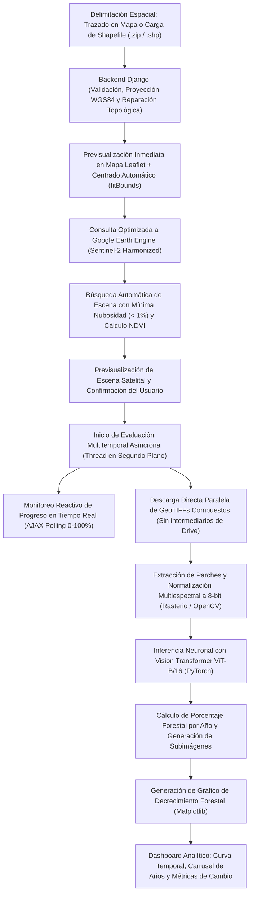

# EcoScan-ViT: Plataforma de Teledetección e Inteligencia Artificial para el Monitoreo Multitemporal de Cobertura Forestal

[](https://www.python.org/)
[](https://www.djangoproject.com/)
[](https://pytorch.org/)
[](https://earthengine.google.com/)
[](https://leafletjs.com/)

**EcoScan-ViT** es una plataforma web geoespacial y de visión por computadora diseñada para la delimitación, detección satelital y análisis histórico multitemporal de la cobertura y pérdida forestal (deforestación, incendios y degradación del suelo). 

A través de la integración nativa con **Google Earth Engine (GEE)** y modelos de aprendizaje profundo basados en **Vision Transformers (ViT)**, la plataforma permite analizar la evolución cronológica interanual de cualquier región geográfica del planeta en cuestión de segundos, generando gráficos de tendencia, imágenes satelitales clasificadas y estadísticas de superficie boscosa.

---

## 🗺️ Diagrama de Flujo del Sistema



---

## 🚀 Capacidades y Funcionalidades del Sistema

### 1. Interfaz de Mapeo Interactiva (Estilo Google Earth Engine)
- **Visualizador Geoespacial en Modo Oscuro:** Interfaz inmersiva basada en Leaflet con capas satelitales y de relieve de alta resolución de Google Maps.
- **Herramientas de Dibujo Geométrico:** Barra de herramientas superior idéntica a Google Earth Engine Code Editor (Navegación / Mano, Marcadores, Polilíneas, Polígonos libres y Rectángulos de selección).
- **Cálculo de Superficie en Vivo:** Medición automática del área seleccionada en metros cuadrados ($m^2$) y hectáreas en tiempo real mediante `Turf.js`.
- **Buscador Mundial de Lugares:** Motor de búsqueda integrado con autocompletado geográfico (Nominatim OpenStreetMap) que vuela y centra la vista del mapa de forma instantánea al seleccionar cualquier comuna, región o país.

### 2. Ingesta y Procesamiento Avanzado de Shapefiles
- **Filtro Estricto de Formatos:** Admite archivos vectoriales comprimidos (`.zip`) o el conjunto de archivos componentes de ESRI Shapefile (`.shp`, `.shx`, `.dbf`, `.prj`, `.cpg`).
- **Reparación Topológica Automática:** Utiliza `shapely.validation.make_valid` para corregir de forma transparente auto-intersecciones y errores geométricos comunes en capas vectoriales complejas (como fiordos, islas y cuencas).
- **Simplificación Adaptativa:** Para shapefiles de alta densidad (más de 10.000 vértices), el sistema aplica el algoritmo Douglas-Peucker preservando más del 99% de la forma y el área real, asegurando un renderizado fluido a 60 FPS en el navegador sin bloquear el hilo principal.
- **Reproyección Geográfica Universal:** Convierte automáticamente cualquier sistema de coordenadas de origen (UTM, SIRGAS, PSAD56, etc.) a coordenadas geodésicas WGS84 (`EPSG:4326`).
- **Carga Inmediata y Centrado:** Al seleccionar el archivo, el mapa detecta el polígono, calcula su *bounding box*, ajusta el zoom al área (`fitBounds`) y completa el formulario automáticamente.

### 3. Captura Satelital Óptima y Consulta Ultrarrápida (GEE)
- **Detección de Escena más Limpia:** Consulta de forma inteligente la colección `COPERNICUS/S2_HARMONIZED`, filtrando capturas recientes con menos del **1% de nubosidad** para garantizar una imagen limpia y libre de artefactos atmosféricos.
- **Metadatos Unificados:** Obtiene en un solo viaje de red la fecha real de captura satelital, el porcentaje exacto de nubes en la escena y una estimación de cobertura de vegetación basada en el Índice de Vegetación de Diferencia Normalizada (NDVI).
- **Previsualización Satelital:** Despliega la escena antes de guardar, mostrando la resolución espacial, fecha de captura y porcentaje de bosque estimado.

### 4. Motor de Inferencia Multitemporal con Vision Transformer (ViT)
- **Descargas Sincrónicas Directas:** El sistema descarga directamente los rásteres GeoTIFF multiespectrales (bandas B4, B3, B2) desde la API de Earth Engine en paralelo, eliminando la dependencia de colas de exportación en la nube o Google Drive y reduciendo el tiempo de procesamiento de 15 minutos a **15–25 segundos**.
- **Segmentación Espacial Georreferenciada:** El polígono de estudio se descompone en una grilla de parches geoespaciales homogéneos con `rasterio`.
- **Clasificador Neuronal ViT-B/16:** Cada parche recortado se normaliza a 8 bits y se clasifica mediante una red neuronal profunda preentrenada y especializada en teledetección satelital, discriminando entre bosque nativo/denso y otros usos de suelo (suelo desnudo, cultivos, zonas urbanas, cuerpos de agua).
- **Procesamiento Multianual:** Realiza la inferencia para cada año de la serie histórica (desde 2018 hasta el año en curso), construyendo la línea temporal de evolución ecológica.

### 5. Monitoreo en Tiempo Real y Tablero de Resultados
- **Barra de Progreso Reactiva (AJAX):** Diálogo modal interactivo con indicador porcentual (0% a 100%) y descripción detallada del paso en ejecución (descarga de ráster, segmentación, año analizado y avance de parches evaluados).
- **Gráfica de Decrecimiento Forestal:** Curva de evolución interanual generada dinámicamente con `Matplotlib`, graficando la tendencia histórica de la masa boscosa.
- **Carrusel y Visor de Escenas Históricas:** Galería de imágenes PNG clasificadas por año para comparar visualmente los cambios de cobertura vegetal a través del tiempo.
- **Gestión Integral de Áreas de Estudio:** Permite consultar análisis previos guardados en la base de datos o eliminarlos permanentemente (borrando de forma limpia sus registros y archivos asociados en disco).

---

## 🌲 Colección de Shapefiles de Prueba Incluidos

El repositorio incluye colecciones cartográficas listas para usar en pruebas y demostraciones:

### A. Zonas Afectadas por Deforestación e Incendios (`shapefiles/zonas_deforestadas_chile/`)
Áreas ubicadas en valles, secano costero y colinas bajas de Chile central que sufrieron pérdidas forestales masivas (ideales para evidenciar caídas drásticas en la curva del modelo ViT):

- `Sector_Huallerehue_Santa_Juana_Biobio.zip`: Sector afectado por el megaincendio Santa Ana de 2023 (pérdida superior al 70% de cobertura).
- `Sector_Santa_Olga_Empedrado_Maule.zip`: Epicentro del megaincendio Las Máquinas de 2017 (Tormenta de Fuego).
- `Sector_El_Cortijo_Rafael_Tome_Biobio.zip`: Cerros costeros ondulados quemados en febrero de 2023.
- `Sector_Cerro_Cayumanque_Quillon_Nuble.zip`: Lomas boscosas con incendios recurrentes y sustitución de suelo.
- `Sector_Carrizal_Nacimiento_Biobio.zip`: Zonas de llanura baja con tala rasa industrial y quemas forestales.
- **Comunas completas:** Polígonos oficiales de Santa Juana, Empedrado, Quillón, Tomé, Florida y Nacimiento.

### B. Reservas y Parques Forestales (`shapefiles/bosques_chile/`)
Límites oficiales de conservación del SNASPE (CONAF):
- `Reserva_Nacional_Nonguen_Biobio.zip` (Concepción, Bío-Bío)
- `Parque_Nacional_Conguillio_Araucania.zip`
- `Parque_Nacional_Alerce_Costero_Los_Rios.zip`
- `Parque_Nacional_Huerquehue_Araucania.zip`
- `Parque_Nacional_Nahuelbuta_Araucania.zip`
- `Parque_Nacional_Vicente_Perez_Rosales_Los_Lagos.zip`

---

## 🛠️ Tecnologías y Librerías Utilizadas

| Categoría | Tecnología | Función |
| :--- | :--- | :--- |
| **Backend Web** | Django 4.2.x | Enrutamiento, modelos ORM, endpoints AJAX y arquitectura MVC. |
| **Deep Learning** | PyTorch, Torchvision | Motor de inferencia del Vision Transformer (ViT-B/16). |
| **Plataforma Geoespacial** | `earthengine-api` (GEE) | Conexión con los almacenes satelitales en la nube de Google. |
| **Manejo Vectorial** | `geopandas`, `shapely` | Lectura de Shapefiles, reproyección WGS84, simplificación topológica y cálculo de geometrías. |
| **Manejo Ráster** | `rasterio`, `Pillow`, `OpenCV` | Procesamiento de GeoTIFFs multiespectrales, máscaras espaciales y codificación PNG. |
| **Cálculo Científico** | `numpy`, `matplotlib` | Operaciones matriciales, normalización de bandas y generación de gráficos de tendencia. |
| **Frontend** | Leaflet 1.9, Leaflet-Geoman, Turf.js, Bootstrap | Visor cartográfico interactivo, herramientas vectoriales y diseño en modo oscuro. |

---

## 🗃️ Modelo de Base de Datos

```
  ┌─────────────────────────────────┐          1:N          ┌──────────────────────────────────┐
  │         ImagenSatelital         │──────────────────────>│        SubImagenSatelital        │
  ├─────────────────────────────────┤                       ├──────────────────────────────────┤
  │ id (PK)                         │                       │ id (PK)                          │
  │ name (Char)                     │                       │ imagen_id (FK)                   │
  │ coordenadas (JSON Array String) │                       │ subImagen (ImageField / PNG)     │
  │ satelite (FK -> Satelite)       │                       │ anio_imagen (Char / Ej: "2023")  │
  │ tipo_imagen (FK -> Tipo_Imagen) │                       │ porcentaje (Decimal / Cobertura) │
  └─────────────────────────────────┘                       └──────────────────────────────────┘
```

---

## 📁 Estructura del Proyecto

```
tesisgaubert/
├── ecoscan_vit/                  # Configuración central del proyecto Django
│   ├── settings.py               # Configuración de límites de carga, BD y apps
│   ├── urls.py                   # Enrutador principal de URLs
│   └── wsgi.py
├── mapas/                        # Aplicación principal de teledetección
│   ├── models.py                 # Modelos ImagenSatelital, Satelite, Tipo_Imagen
│   ├── views.py                  # Endpoints AJAX, descargas GEE y pipeline ViT
│   ├── forms.py                  # Formularios con validación de Shapefiles
│   ├── urls.py                   # Rutas: mapas, cargar_shapefile, evaluacion, etc.
│   └── templates/                # Vistas HTML con interfaz modo oscuro
│       ├── base.html
│       ├── maps.html             # Mapa interactivo Leaflet / GEE y panel lateral
│       ├── visualizar_imagen.html# Previsualización satelital y confirmación
│       └── evaluacion.html       # Tablero analítico multitemporal y carrusel
├── shapefiles/                   # Almacén de capas vectoriales
│   ├── bosques_chile/            # 10 Shapefiles oficiales de parques y reservas
│   ├── zonas_deforestadas_chile/ # Shapefiles de hotspots de deforestación e incendios
│   ├── generated/                # Shapefiles generados a partir de dibujos en el mapa
│   └── temp/                     # Espacio temporal para descompresión de archivos
├── ViT_Satellite.pth             # Pesos entrenados del modelo Vision Transformer
├── manage.py
└── requirements.txt              # Dependencias de Python
```

---

## 💻 Instalación y Ejecución Local

### Prerrequisitos
- Python 3.9 o superior.
- Librería del sistema GDAL (en macOS: `brew install gdal`).
- Cuenta habilitada en [Google Earth Engine](https://earthengine.google.com/).

### 1. Clonar el repositorio y preparar el entorno
```bash
git clone https://github.com/CarlosGaubert/EcoScan-ViT.git
cd EcoScan-ViT

# Crear y activar entorno virtual
python3 -m venv venv
source venv/bin/activate

# Instalar dependencias
pip install --upgrade pip
pip install -r requirements.txt
```

### 2. Autenticación con Google Earth Engine
Autentica tu sesión de Earth Engine ejecutando:
```bash
earthengine authenticate
```
*Se abrirá el navegador para autorizar tu cuenta de Google y vincular el token de acceso local.*

### 3. Migrar la base de datos e iniciar el servidor
```bash
python manage.py migrate
python manage.py runserver 127.0.0.1:8001
```

Abre tu navegador e ingresa a:
👉 **`http://127.0.0.1:8001/`**

---

## 🔬 Flujo de Trabajo en la Plataforma

1. **Delimitar el Área de Interés:**
   - Dibuja un polígono o rectángulo sobre el mapa con las herramientas de la barra superior, **o bien**:
   - Sube un archivo Shapefile (`.zip`) en el panel lateral (puedes usar los ejemplos incluidos en `shapefiles/zonas_deforestadas_chile/`).
2. **Descargar y Previsualizar:**
   - Haz clic en **"Descargar Imágen"**. El sistema seleccionará automáticamente la captura Sentinel-2 más reciente con menos del 1% de nubes y calculará el porcentaje forestal estimado.
3. **Iniciar Evaluación Multitemporal:**
   - Revisa la imagen satelital y presiona **"Guardar"**.
   - El sistema iniciará la inferencia neuronal en segundo plano con el modelo Vision Transformer (ViT), mostrando el avance porcentual en tiempo real.
4. **Analizar los Resultados:**
   - Al finalizar, el sistema redirige automáticamente al **Tablero Analítico**, donde podrás examinar la curva de decrecimiento forestal año por año, comparar las imágenes satelitales en pantalla completa e identificar cuándo y cuánto bosque se perdió en el área seleccionada.
